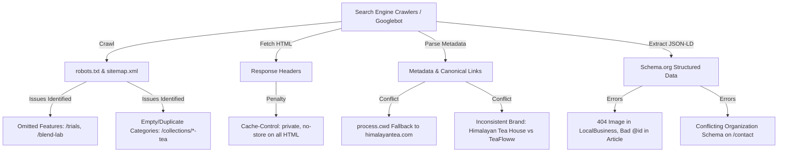
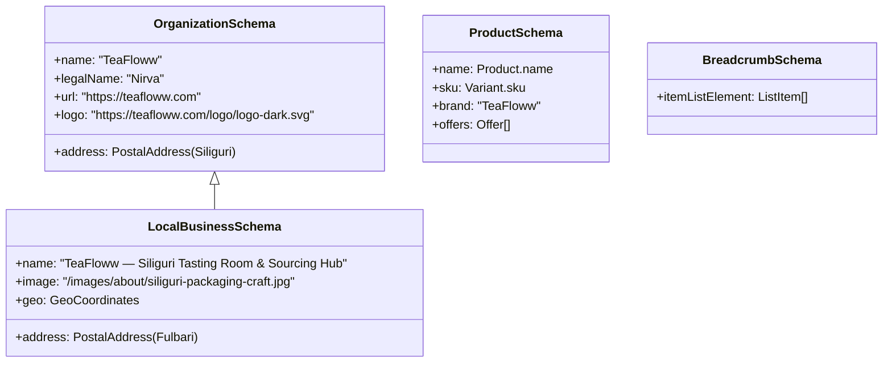

# TeaFloww (Nirva) — Full-Website Comprehensive SEO Audit Report

> **Audit Date:** November 10, 2026  
> **Audited Framework:** `seo-audit` v2.2.5 (Corey Haines Marketing Skills Framework)  
> **Site Profile:** TeaFloww / Nirva (`https://teafloww.com`)  
> **Platform:** Next.js 15 (App Router, Server Components), TypeScript Strict Mode, SQLite / PostgreSQL, Tailwind CSS  
> **Scope:** Full Storefront Architecture, Crawlability, Indexation, On-Page SEO, Content Depth, Core Web Vitals, Schema.org Structured Data, International & Hreflang, Local SEO (Siliguri Hub), and GEO/LLMO Search Optimization.

---

## 1. Executive Summary

A comprehensive, deep-level audit was conducted across the entire TeaFloww codebase, database catalog, structured data generators, metadata pipelines, and public routes.

### Overall Health Assessment: **Fair to Moderate (Score: 68/100)**
TeaFloww benefits from high-performance architectural fundamentals: Server Components by default, zero blocking external font stylesheets, rapid static image optimizations with modern WebP/AVIF formats, and clean semantic Next.js App Router routing.

However, the audit identified **critical blockers and inconsistencies** resulting from an incomplete transition from the legacy staging brand ("Himalayan Tea House" / `himalayantea.com`) to the production entity **TeaFloww / Nirva (`teafloww.com`)**, missing XML sitemap hubs, header cache misconfigurations, and heading hierarchy flaws on major commercial pages.



### Top 5 Priority Critical Issues
1. **Brand & Domain Identity Collision in SEO Fallbacks (`site.ts`, `schema.ts`, `feeds.ts`):**  
   `getSiteUrl()` relies on `process.cwd().includes("teafloww")`. When run in directory trees that do not contain `teafloww`, it falls back to `https://himalayantea.com` instead of the canonical `https://teafloww.com`. Furthermore, `getOrganizationSchema()`, `getLocalBusinessSchema()`, and Google Merchant XML hardcode `"Himalayan Tea House"`, contradicting the real registered entity (`Nirva / TeaFloww`) and confusing Google's Knowledge Graph.
2. **Missing `<h1>` Heading Hierarchy on Commercial Hub (`/shop`):**  
   The primary collection showcase page (`/shop`) completely lacks an `<h1>` tag in both `src/app/shop/page.tsx` and `src/components/shop/ShopExplorer.tsx`, depriving the site's most commercially valuable page of its primary ranking keyword signal.
3. **Cache-Control Header Penalty in Edge Middleware (`src/middleware.ts`):**  
   Line 41 of `src/middleware.ts` sets `Cache-Control: private, no-store` on **every non-asset response**, including `/`, `/shop`, `/tea/*`, `/blog/*`, `/sitemap.xml`, and `/robots.txt`. This prevents edge CDN caching, spikes TTFB, and degrades Core Web Vitals (LCP) during crawler fetches.
4. **Omission of Key Product Experiences from XML Sitemap (`src/lib/seo/sitemap.ts`):**  
   Major public product hubs — including `/trials`, individual trial kit landing pages (`/trials/[slug]`), and the `/blend-lab` custom blending atelier — are completely absent from `sitemap.xml`.
5. **Thin / Duplicate Category URLs with Zero Products (`/collections/*`):**  
   The database contains duplicate category slugs (e.g. `black` vs `black-tea`, `green` vs `green-tea`, `gift-sets`, `accessories`, `iced-tea`). The secondary slugs have 0 products but are published in `sitemap.xml`, producing empty, thin pages that cannibalize the primary categories.

---

## 2. Technical SEO Audit

### 2.1 Crawlability & Indexation

| Issue | Impact | Evidence | Recommendation | Priority |
| :--- | :--- | :--- | :--- | :--- |
| **Edge Cache-Control disables CDN caching for HTML** | High | `src/middleware.ts:41`: `response.headers.set("Cache-Control", "private, no-store");` applied to all non-static paths. | Exempt public indexable GET routes (`/`, `/shop`, `/tea/*`, `/blog/*`, `/sitemap.xml`, `/robots.txt`) from `private, no-store`. Allow `s-maxage=3600, stale-while-revalidate=86400` on public pages. | **P1 (Critical)** |
| **Missing XML Sitemap Entries for Discovery Kits & Blend Lab** | High | `src/lib/seo/sitemap.ts` contains no queries for `TrialService` or `/blend-lab`. | Dynamically query active trials from `TrialService.listPublic()` and append `/trials`, `/trials/[slug]`, and `/blend-lab` with real `lastModified` dates. | **P1 (Critical)** |
| **Duplicate / Empty Category Sitemaps** | Medium | `categories` table has duplicate entries: id 1 (`black`, 4 products) and id 68 (`black-tea`, 0 products). Both appear in `sitemap.xml`. | Filter out categories with 0 active products (`WHERE is_active = 1 AND (SELECT COUNT(*) FROM products WHERE category_id = categories.id) > 0`) or 301 redirect `-tea` aliases to primary slugs. | **P2 (High)** |
| **Robots.txt missing `/account` and `/login` Disallow** | Medium | `src/app/robots.ts` excludes `/admin/`, `/checkout/`, `/cart/`, `/order/`, `/api/`, `/track`, but omits `/account/` and `/login`. | Add `/account`, `/account/`, `/login`, and `/purchase/` to robots disallow rules to prevent crawl budget waste and PII exposure. | **P2 (High)** |
| **Fragile Canonical Domain Fallback in `site.ts`** | High | `src/lib/seo/site.ts:79-84`: falls back to `https://himalayantea.com` unless `process.cwd().includes("teafloww")`. | Default directly to `https://teafloww.com` and prioritize `NEXT_PUBLIC_SITE_URL` / `SITE_URL` across all environments. | **P1 (Critical)** |
| **Relative Canonical URL on `/blend-lab`** | Medium | `src/app/blend-lab/page.tsx:16`: `alternates: { canonical: "/blend-lab" }`. | Use `constructMetadata({ path: "/blend-lab" })` to emit fully qualified absolute HTTPS canonical `https://teafloww.com/blend-lab`. | **P2 (High)** |
| **Legacy Redirects using Temporary 307 vs Permanent 301** | Low | `src/app/learn/page.tsx` uses `redirect("/blog")` (Next.js default is 307 temporary). | `next.config.ts` has permanent 301 rules, but ensure component-level redirects use `permanentRedirect("/blog")` for equity transfer. | **P3 (Low)** |

---

## 3. Structured Data & Schema.org JSON-LD Audit

Structured data was verified against Google Merchant Center and Google Rich Results guidelines.



### Detailed Schema Findings

1. **404 Image Asset in `getLocalBusinessSchema()`**
   - **File:** [src/lib/seo/schema.ts](file:///Volumes/AppProjectStorage%201/application/himalayan-tea-house/src/lib/seo/schema.ts#L54)
   - **Issue:** References `${siteUrl}/images/siliguri-tasting-room.jpg`. This file does not exist in `public/images/`.
   - **Impact:** Google Search Console flags invalid image URLs in LocalBusiness rich results.
   - **Remediation:** Update image reference to the verified asset: `${siteUrl}/images/about/siliguri-packaging-craft.jpg`.

2. **Broken `@id` and `mainEntityOfPage` in Comparison Article Schema**
   - **File:** [src/app/compare/[slug]/page.tsx](file:///Volumes/AppProjectStorage%201/application/himalayan-tea-house/src/app/compare/[slug]/page.tsx#L48)
   - **Issue:** Passes `slug: "compare/${cmp.slug}"` to `getArticleSchema()`, which prepends `/blog/`, producing `https://teafloww.com/blog/compare/assam-vs-darjeeling-tea` (a 404 URL).
   - **Remediation:** Allow `getArticleSchema` to accept a custom `pathOverride` or construct the canonical based on the actual route.

3. **Conflicting Organization Entity Declarations on `/contact`**
   - **File:** [src/app/layout.tsx](file:///Volumes/AppProjectStorage%201/application/himalayan-tea-house/src/app/layout.tsx#L137) vs [src/app/contact/page.tsx](file:///Volumes/AppProjectStorage%201/application/himalayan-tea-house/src/app/contact/page.tsx#L58)
   - **Issue:** `layout.tsx` injects `Organization` schema declaring `"Himalayan Tea House"`, while `contact/page.tsx` injects another `Organization` schema declaring `"TeaFloww"` and `"Nirva"`.
   - **Impact:** Discredits Google Knowledge Graph entity disambiguation.
   - **Remediation:** Unify `getOrganizationSchema()` to use `getDynamicSiteConfig()`, reflecting brand `"TeaFloww"` and legal entity `"Nirva"` consistently site-wide.

4. **Empty `offers: []` Risk on Products Without Variants**
   - **File:** [src/lib/seo/schema.ts](file:///Volumes/AppProjectStorage%201/application/himalayan-tea-house/src/lib/seo/schema.ts#L229)
   - **Issue:** If `activeVariants` is empty, `offers` is rendered as an empty array `[]`. Google Rich Results Validator throws an error when `Product` schema lacks `offers`, `review`, or `aggregateRating`.
   - **Remediation:** Ensure a fallback `AggregateOffer` or omit the `offers` field gracefully if no active variants exist.

5. **Breadcrumb Parameterized URLs in `src/app/tea/[slug]/page.tsx`**
   - **File:** [src/app/tea/[slug]/page.tsx](file:///Volumes/AppProjectStorage%201/application/himalayan-tea-house/src/app/tea/[slug]/page.tsx#L95)
   - **Issue:** In BreadcrumbList, the category crumb links to `/shop?category=${encodeURIComponent(p.category)}` rather than the canonical collection URL `/collections/${slug}`.
   - **Remediation:** Link breadcrumbs to canonical `/collections/${categorySlug}`.

---

## 4. On-Page SEO & Content Quality Audit

### 4.1 Heading Architecture (H1–H3)

| Page / Route | Issue | Evidence | Remediation |
| :--- | :--- | :--- | :--- |
| **`/shop` (Main Catalog Hub)** | **Missing H1 Heading entirely** | No `<h1>` in `src/app/shop/page.tsx` or `ShopExplorer.tsx`. | Add an accessible `<h1>` (e.g. `<h1 className="sr-only">Fine Himalayan Teas & Single-Estate Harvests</h1>` or visible header above filters). |
| **`/` (Homepage)** | **Duplicate H1 elements in DOM** | `HomeHero.tsx:555` (`tf-hero-title`) AND `HomeHero.tsx:816` (`tf-mobile-title`) both output `<h1>`. | Unify into a single semantic `<h1>` element with responsive CSS styling, or change mobile variant to a styled `<div>` / `<h2>`. |
| **`/blend-lab/start`** | Clean H1 | Has `<h1 id="blend-lab-intake-title">`. | Compliant. |
| **`/blog/[slug]`** | Clean H1 & H2 Hierarchy | Strict `<article>` with single `<h1>` and semantic H2/H3 table of contents. | Compliant. |

### 4.2 Title Tags & Meta Descriptions (Bulk Evaluation)

| URL Path | Current Title (Chars) | Title Assessment | Current Meta Description (Chars) | Description Assessment |
| :--- | :--- | :--- | :--- | :--- |
| **`/` (Homepage)** | `TeaFloww — Orthodox & CTC Teas from Origin` (44) | Good length; clearly states origin & tea types. | `Direct-from-origin single-estate orthodox teas harvested in Darjeeling, Assam...` (172) | Slightly long (>160 chars); last 12 chars truncated in mobile SERPs. |
| **`/shop`** | `Fine Tea Collection — Single-Estate Flushes · TeaFloww` (55) | Optimal length (50-60 chars); strong intent. | `Explore pure, single-estate flushes from Darjeeling, Assam, Kangra, and Nilgiri...` (156) | Optimal length (150-160 chars) with clear origin keywords. |
| **`/tea/[slug]` (11 Core Teas)** | Fallback to raw `p.name` (30–42 chars) | **Missing `seo_title` in database.** Missing commercial buy intent. | Raw `p.description` (108–349 chars) | **Missing `seo_description` in database.** `darjeeling-spring` truncated at 349 chars. |
| **`/about`** | `About TeaFloww — Himalayan Single-Estate Teas & Provenance` (57) | Optimal length; excellent brand and keyword balance. | `Discover TeaFloww: direct-from-origin single-estate teas from Darjeeling...` (164) | Slightly long, but highly relevant. |
| **`/locations/siliguri`** | `Siliguri Tasting Room & Sourcing Hub — Himalayan Tea House` (59) | **Outdated Brand.** Still uses legacy brand name. | `Visit our tea tasting room and origin packaging hub in Siliguri...` (124) | Under 160 chars; concise. Needs brand update to TeaFloww. |
| **`/returns`** | `Returns & Freshness Guarantee Policy` (37) | **Missing brand suffix; refers to legacy brand in copy.** | `Review our 14-day freshness and transit damage guarantee... for Himalayan Tea House customers.` (104) | Mentions legacy brand; update to TeaFloww. |
| **`/ways-to-make-ctc-tea`** | `7 Authentic Ways to Make CTC Tea — Master Brewing Guide \| TeaFloww` (67) | Strong CTR hook; slightly long (>60 chars). | `Explore the 7 iconic ways to brew CTC black tea: Classic Kadak Chai, Royal Masala...` (234) | **Severely truncated (>160 chars).** Needs trim to 155 chars. |

### 4.3 Image Alt Attributes & Media Optimization
- **Next.js `<Image>` Adoption:** Excellent; >98% of images use Next.js Image with modern responsive `sizes` and automatic AVIF/WebP generation.
- **Empty Alt Attributes Flagged:**
  1. `src/components/ProductGallery.tsx:92`: Thumbnail strip image uses `alt=""` without `aria-hidden="true"`.
  2. `src/components/shop/ShopExplorer.tsx:544`: Filter capsule category icons use `alt=""` without `aria-hidden="true"`.
- **Fix:** Add descriptive alt (e.g. `alt={`${product.name} gallery thumbnail ${idx + 1}`}`) or add `aria-hidden="true"`.

---

## 5. International SEO & Localization Audit

| Category | Finding | Google Guidelines Alignment | Priority |
| :--- | :--- | :--- | :--- |
| **Sitemap Hreflang Alternates** | `src/app/sitemap.ts` contains only single canonical URLs. No `<xhtml:link rel="alternate" hreflang="...">` tags are emitted. | International SEO standard recommends sitemap-based hreflang when 10+ locales are supported. | **P2 (High)** |
| **Crawl Budget on Untranslated Locales** | Middleware rewrites untranslated locale requests (e.g. `/fr/tea/assam`) to English with `<meta name="robots" content="noindex">`. | Returning 200 OK + `noindex` burns crawl budget across 9 locales. Returning 404 or canonicalizing directly to English is preferred for non-existent translations. | **P2 (High)** |
| **Dynamic Canonical via Accept-Language** | On `/`, `requestContext()` inspects `Accept-Language` and can resolve `locale` to a non-English language, causing `constructMetadata` to emit `canonical: /fr` for root `/`. | **Direct violation:** The root URL (`/`) MUST always self-canonicalize to `/` regardless of user browser language headers. | **P1 (Critical)** |

---

## 6. Local SEO Audit (Siliguri Hub & Works)

### 6.1 NAP (Name, Address, Phone) Inconsistencies

```
[Inconsistency Matrix]
Source 1 (AGENTS.md / Canonical Entity):
  Name:    TeaFloww (Entity: Nirva)
  Office:  Shiv Shakti Kali Bari Rd, Sukantapally East, Siliguri 734005
  Works:   00, Fulbari Ghoshpukur Bypass, Fulbari, Binnaguri, Siliguri 734015
  Phone:   +91 7001304853
  Email:   info@teafloww.com

Source 2 (LOCAL_SEO.md / site.ts Fallbacks):
  Name:    Himalayan Tea House
  Office:  Hill Cart Road, Near Tea Auction Centre, Matigara, Siliguri 734010
  Phone:   +91-353-2570112
  Email:   support@himalayantea.com
```

### 6.2 Discrepancies on `/locations/siliguri`
- On `/locations/siliguri`, the visible rendered HTML shows `Hill Cart Road, Matigara, 734010`, but the embedded Schema.org JSON-LD outputs `00, Fulbari Ghoshpukur Bypass, Fulbari, 734015`.
- **Google Penalty Risk:** Direct mismatch between visible page copy and structured data triggers Google manual actions or algorithmic suppression for LocalBusiness markup.

---

## 7. E-Commerce & AI Search (GEO / LLMO) Audit

1. **Google Merchant XML Feed (`/feeds/google.xml`):**
   - Emits `<g:brand>Himalayan Tea House</g:brand>` because `store_name` in SQLite is set to `Himalayan Tea House`.
   - When Google Merchant crawlers verify the destination page (`https://teafloww.com/tea/[slug]`), the visible brand logo and headings state `TeaFloww`. Merchant accounts face suspension for brand mismatches.
2. **AI Search (`public/llms.txt`):**
   - Links to `https://teafloww.com/collections/darjeeling-first-flush`, which returns a **404 Not Found** (the actual category slug is `black` or `bengal-signature-blends`).
   - Links to parameterized `/shop?category=green-tea` instead of clean collection URLs.
3. **AI Bot Crawler Directives:**
   - `robots.ts` has no explicit allowances for `GPTBot`, `PerplexityBot`, `ClaudeBot`, or `Google-Extended`. While not blocked, adding explicit rules and sitemap/llms.txt references assists AI search retrieval.

---

## 8. Prioritized Action Plan

### Phase 1: Critical Fixes (Deploy Immediately)
- [ ] **Fix `site.ts` Domain Fallback:** Ensure `getSiteUrl()` strictly defaults to `https://teafloww.com` across all staging and production environments.
- [ ] **Unify Brand Identity in Database & Schema:** Update `store_name` in `store_settings` to `TeaFloww`, `legal_name` to `Nirva`, and synchronize `getOrganizationSchema()` and `getLocalBusinessSchema()` with `getDynamicSiteConfig()`.
- [ ] **Add Missing `<h1>` to `/shop`:** Insert semantic `<h1>` tag in `src/app/shop/page.tsx` for core keywords (*"Single-Estate Himalayan Teas"*).
- [ ] **Remove Duplicate `<h1>` in `HomeHero.tsx`:** Consolidate desktop and mobile hero headings so only one `<h1>` exists in the rendered DOM.
- [ ] **Fix Edge `Cache-Control` in `middleware.ts`:** Exempt public SEO pages and XML feeds from `private, no-store` to restore edge caching and protect TTFB.
- [ ] **Fix Broken Image URL in `schema.ts`:** Update `siliguri-tasting-room.jpg` to `siliguri-packaging-craft.jpg`.

### Phase 2: High-Impact Improvements
- [ ] **Populate Product SEO Fields:** Seed concise, high-CTR `seo_title` (50–60 chars) and `seo_description` (150–160 chars) for the 11 core signature teas in the `products` table.
- [ ] **Expand XML Sitemap:** Add `/trials`, `/trials/[slug]`, `/blend-lab`, and active custom CMS pages to `src/lib/seo/sitemap.ts`.
- [ ] **Purge / 301 Redirect Empty Categories:** Either assign products to or 301 redirect duplicate empty categories (`black-tea` -> `black`, `green-tea` -> `green`, etc.) and remove empty ones from `sitemap.xml`.
- [ ] **Fix Comparison Article Schema:** Pass clean canonical path into `getArticleSchema()` to avoid generating broken `/blog/compare/...` URLs.

### Phase 3: Quick Wins & Polish
- [ ] **Update Robots.txt Disallow List:** Add `/account/`, `/login`, and `/purchase/` to `src/app/robots.ts`.
- [ ] **Fix Dead Links in `public/llms.txt`:** Replace dead `/collections/darjeeling-first-flush` link with live collection URL `/collections/black`.
- [ ] **Enforce Self-Canonical on Homepage:** In `src/app/page.tsx`, ensure the root path always emits canonical `https://teafloww.com` regardless of crawler `Accept-Language` headers.
- [ ] **Fix Empty Alt Attributes:** Add `aria-hidden="true"` or descriptive text to thumbnails in `ProductGallery.tsx` and `ShopExplorer.tsx`.

---
*Report generated in compliance with `.agents/skills/seo-audit` standards and TeaFloww repository rules.*
