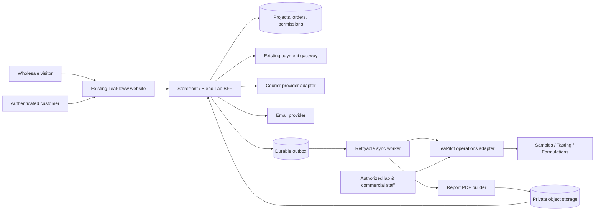

# System Architecture — Contracts, Boundaries & Reliability

## 1. Logical topology



**Not a deployment diagram:** actual services and framework remain subject to integration discovery. A separate microservice is not required if a well-separated module fits the existing codebase.

## 2. Bounded contexts
- **Marketing:** page copy, service comparison, static demonstrations, metadata.
- **Catalog & billing:** service SKU, entitlement version, price snapshot, tax, payment, invoice and refunds.
- **Blend Lab project:** intake, customer requirements, status, sample custody and event history.
- **Evaluation:** tester protocol, readings, photos, observations, reviewer signoff.
- **Formulation:** ingredients, lot allocations, recipe versions, trial production, sensory approval.
- **Documents:** reports, PDF revisions, access and delivery events.
- **Commercial:** authorized quotes, MOQ, terms, order conversion.
- **Communication:** emails, notifications, opt-in, retries.

## 3. Data ownership & synchronization
- Storefront/billing owns definitive payment status and customer-facing invoice.
- Project DB owns customer-project mapping and events.
- TeaPilot owns authoritative professional tasting and formula data *only after connector capability is verified*.
- When data is copied into project read models, store source ID, version, timestamp and originating system.
- Never make two systems co-authoritative for the same financial amount or recipe version.

## 4. Sync pattern
1. Payment webhook is signature verified.
2. Transaction updates payment state and inserts an outbox message using a unique provider event ID.
3. Worker sends project-intake notification to TeaPilot adapter, with idempotency key.
4. Connector failure creates a retry job (exponential backoff + dead-letter alert) without changing payment to unpaid.
5. Readback confirms external sample/project linkage before showing internal work started.
6. The customer sees `Confirmed — preparation pending`, not `Evaluation started`, until staff workflow truly begins.

## 5. Financial safety
- All price calculations occur server-side in integer paise.
- Preserve `plan_id`, `plan_version`, `quoted_total_paise`, `tax_classification`, `tax_rate_basis_points`, and customer acceptance version.
- Refund policy and amount calculations must be traceable and not guessed.
- Payment webhook processing uses unique `provider_event_id` and a transactional update.
- Payment amount and currency must match the payment intent/order stored on server.
- Refund events require ledger state transitions and courier/ops reconciliation.

## 6. Permissions
Customer:
- Own projects, billing documents, approved customer-visible report versions, quote versions, tracking and feedback.
- Cannot access supplier lot costs, raw recipe ratios, staff notes, other customers' samples or internal review marks.

Tester:
- Assigned samples/tasting forms; no payment refunds or customer PII beyond required contact.

Reviewer:
- Approves report, can request correction; no impersonation.

Commercial:
- Creates quotes; approves margin and sourcing availability; internal costs protected from customer API.

Admin:
- Role-based exceptional actions with audit trail.

## 7. API guidance
- Prefer existing auth and router conventions, with a versioned `/api/blend-lab/...` surface if supported.
- Validate input with shared typed schema; re-validate server-side.
- API returns only view-model DTOs, never raw database/TeaPilot entities.
- Rate-limit uploads and public draft creation; bound file sizes and validate MIME+content.
- Use opaque public project IDs, not sequential order IDs exposed in URLs.
- Pagination and date filtering for internal queues.

## 8. Attachments/report security
- Private object storage only; generate expiring signed downloads after authorization.
- HTML escape uploaded/custodied text used in reports; sanitize SVG/HTML.
- File malware scanning or trusted file handling policies as available.
- Do not attach confidential reports to unintended recipients; verify email ownership before issuing access.
- Store checksum and immutable version ID of every published PDF.

## 9. State machine and recovery
Project status and payment status are distinct. Do not use one broad `status` as a financial, courier and lab truth simultaneously. `STATE_MACHINES.md` defines allowed events and error recovery.

## 10. Reporting & observability
- Correlation ID across request, project, payment, courier and PDF worker.
- Structured redacted logs; never log complete address, report text or proprietary recipe by default.
- Metrics: webhook lag, courier booking failure, intake-to-report latency, failed PDF generation, unauthorized access attempts, and quote approvals.
- Staff dashboard for overdue service work and exceptions.

## 11. Recommended adapter interfaces
```
interface CourierAdapter {
  checkCoverage(input: PickupLocation): Promise<CoverageResult>;
  requestPickup(input: PickupRequest, idempotencyKey: string): Promise<PickupBooking>;
  track(trackingId: string): Promise<ShipmentStatus>;
}
interface TastingAdapter {
  createSampleReceipt(input: IntakePayload, idempotencyKey: string): Promise<ExternalSampleRef>;
  getApprovedEvaluation(externalSampleId: string): Promise<ApprovedEvaluation | null>;
}
interface ReportStorage {
  putImmutable(pdf: Uint8Array, meta: ReportMeta): Promise<StoredReport>;
  createAuthorizedDownload(reportVersionId: string, viewerId: string): Promise<string>;
}
```
These interfaces are design contracts, not claims that existing endpoints currently support them.

## 12. Failure recovery table
| Failure | Desired behaviour |
|---|---|
| Gateway callback reached but webhook delayed | order stays `payment_pending`, shows verify/retry |
| Same webhook delivered twice | dedupe by provider event ID, one project |
| Courier pincode unsupported | prevent paid included-pickup promise or present validated fallback |
| Courier booking fails after payment | `courier_exception`, notify staff, offer defined alternative/refund |
| TeaPilot unavailable | queue project sync, keep customer informed, no data loss |
| PDF generation fails | retry safe job, no premature report-ready email |
| Customer opens another project's ID | 404/403 without sensitive details |
| Quote expired | disallow order conversion, request refreshed quote |
| Formula changed after approval | new version + reapproval required |
