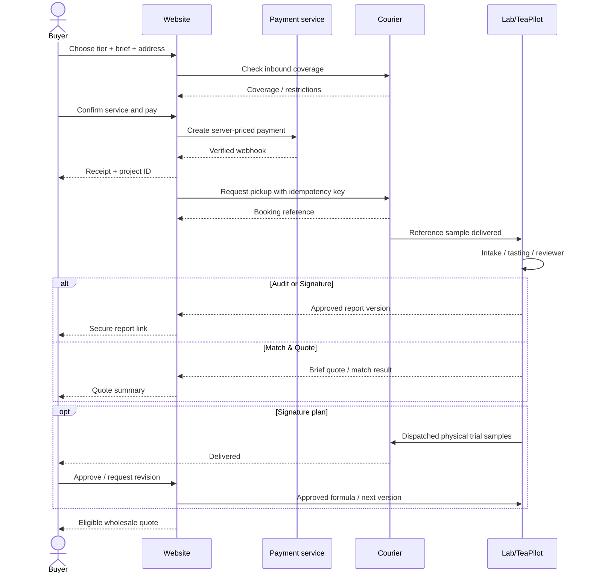

# Sitemap, Screens and Customer Journey

## Proposed routes (adapt to existing router)
| Route | Audience | Primary UI |
|---|---|---|
| `/` | all | existing store + featured Blend Lab module |
| `/blend-lab` | all | premium conversion landing page |
| `/blend-lab/start` | shoppers | plan/intake/coverage/checkout |
| `/blend-lab/thank-you` | paid customer | verified order result and packaging next step |
| `/account/blend-lab` | authenticated customer | projects dashboard |
| `/account/blend-lab/[publicId]` | authorized owner | progress, report, trials, feedback, quote |
| `/account/blend-lab/[publicId]/report/[version]` | authorized owner | accessible report viewer |
| `/staff/blend-lab` | authorized staff | queue (or TeaPilot-native module) |
| `/staff/blend-lab/[id]` | authorized staff | intake, tasting, work items, review |

## Landing content map
1. Hero: one business proposition + service starts at ₹299.
2. Three reassurance points: courier, expert tasting, actionable result.
3. What buyers want to improve (price, strength, consistency, signature).
4. Seven-step physical workflow.
5. What the taster evaluates (real scores, not camera-derived taste).
6. Sample report gallery (synthetic, clearly marked).
7. Quality/cost explorer (illustrative trade-offs).
8. Transparent plans with who each is for.
9. Confidentiality + FAQ + real service terms.
10. Bottom conversion panel.

## Checkout fields
- Step 1 Plan: one of three service SKU identifiers.
- Step 2 Tea: CTC/orthodox/green/flavoured/other, grade (optional), current price (optional), current sourcing quantity, current use.
- Step 3 Goals: lower cost, stronger cup, brighter colour, less bitterness, new recipe, match existing, target sensory sliders; include free-form preferences.
- Step 4 Logistics: name, business, email, phone, GSTIN (if relevant), pickup pincode & full address, return address for premium, consent to sample processing.
- Step 5 Review/pay: line-item amount, inclusive GST as configured, pickup coverage, scope, accepted terms, payment method.

## Customer view-by-plan
| Tab | ₹299 | ₹1,999 | ₹2,999 |
|---|---|---|---|
| Overview | Yes | Yes | Yes |
| Pickup & receipt | Yes | Yes | Yes |
| Status | Yes | Yes | Yes |
| Quotation | Yes | Optional service decision | Yes |
| Detailed PDF | No | Yes | Yes |
| Trials | No | No | Yes |
| Revision feedback | No | No | Yes, defined scope |
| Reorder | On accepted bulk supply | On accepted bulk supply | On accepted bulk supply |

## UI state map
Each form/section must cover: first-use empty, submitting, saved, invalid, network retry, service unavailable, payment pending, payment failed, sample rejected, report locked to plan, link expired, quote expired, report-ready, dispatch delayed, and permission denied.

## Journey sequence

