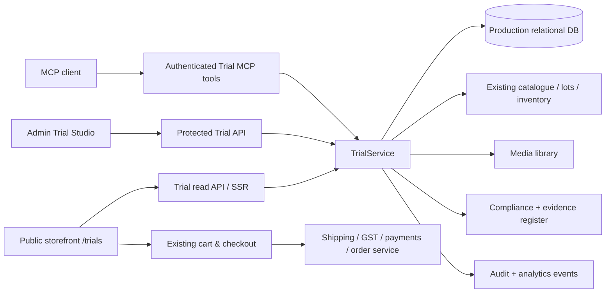

# TEAFLOWW TRIALS — Production Implementation Blueprint v3

**Date:** 6 November 2026  
**Target:** `teafloww.com/trials`, `teafloww.com/trials/:slug`, `/admin/trials`  
**Purpose:** A stunning, conversion-oriented sample-tea storefront whose full content lifecycle is controllable through **the same production records** from TeaFloww Admin and MCP.  
**Status:** Detailed implementation handoff. The prior FastAPI/SQLite module exists and is locally tested; it has **not** been deployed into the production TeaFloww site. Do not infer live checkout or compliance clearance.

## 0 — Executive decisions

1. **First-class `Trial` domain:** Trial listings are distinct from standard retail catalogue products, but link to real product/lot/stock records and use the **existing** checkout, orders, payments, tax and shipping services.
2. **Single source of truth:** Admin HTTP handlers and MCP actions call the **same `TrialService`** with identical validation, revision checks, permissions and audit events; neither writes arbitrary production tables directly.
3. **Publish is a guarded workflow:** `draft → in_review → published → archived` (and `published → draft` for unpublish). Required labelling, media, product provenance and checkout proof are validated at publication. New products are always drafts.
4. **No fabricated proofs:** Savings percentages, testing times, brew counts, colour scores, testimonials and North India adoption are optional, evidence-linked records. The current favourable Siliguri tea-stall response is qualitative feedback, not a validated 50% consumption figure.
5. **Commercially correct:** ₹200 is the proposed **product price** of a four-tea 200 g kit, *not automatically an inclusive delivered price*. At approximately ₹150 delivery for ~1 kg, actual rate lookup and checkout must present total payable transparently.
6. **Visual system:** Keep the uploaded **Himalayan Obsidian / Copper Chai / Gold** studio direction, blend with TeaFloww's **Forest Green / Warm Ivory** identity for premium editorial trust and mobile readability. All sample images and optical readings should be traceable, not mockups mislabelled as lab observations.

### Starting-point verification

The existing local module is under `teafloww_trials/production_module/`:
- `app/main.py`: FastAPI SSR `/trials`, `/trials/{slug}`, `/admin/trials`, protected admin JSON API and public JSON API.
- `app/service.py`: SQLite store, draft/approval restrictions, optimistic revision checks, validation, audit history.
- `app/mcp_server.py`: local MCP SDK bridge with nine draft/status tools; **not** registered in the live TeaFloww MCP connection.
- `app/templates/{base,index,detail,admin}.html`, `app/static/{site.css,admin.js}`, `seed.py` and tests.
- Current local command `pytest -q`: **10 passed** on 6 November 2026.
- The live TeaFloww connector has normal product/category/variant/media actions; a dormant `tea-trials` category existed, but no trial-specific CRUD routes/production installer were verified. Its current `tea-trials` category is **inactive**. Do not activate and promise checkout before release gates are complete.

**Do not mistake the uploaded 763-line design/code draft for deployed software.** It proposes `trial_kits` and `trial_kit_items` plus methods not all present in the current starter. Implementation must reconcile—not overwrite—the tested starter.

---

## 1 — Customer experience and product information architecture

### Primary buyer personas

| Persona | Problem | Immediate question | Conversion path |
|---|---|---|---|
| Tea-stall operator | Milk tea taste/colour and per-cup cost | “Will my regular customers like this?” | Reel → `/trials` → kit → payment → compare → 2/5/10 kg reorder |
| Multi-stall operator | Batch consistency, reliable supply | “Will every delivery perform the same?” | Evidence → sample kit → bulk quote → recurring refill |
| Café/restaurant owner | Convenient flavoured chai | “How do I compare all four?” | Collection filter → flavour comparison → kit → reorder |

### Public routes (SEO-indexable only for approved published inventory)

| Route | Purpose | Access | Definition of done |
|---|---|---|---|
| `/trials` | High-impact dedicated trial landing/catalogue | Public | Lists published records only; search, category/occasion filters, server-rendered and mobile-fast |
| `/trials/:slug` | Conversion-rich trial details | Public | All required product details, visual comparison, transparent landed quote, truthful savings tool, checkout |
| `/trials/:slug/how-to-test` *(optional anchor)* | Three-step controlled test protocol | Public | Same milk/water ratio, dose and brewing time instructions with no unverified comparative result |
| `/trials/order/:orderId` *(use existing order route preferred)* | Tracking and feedback | Authenticated/order-token | Customer-specific tracking with secure access, not public enumeration |
| `/admin/trials` | Manage and filter trials | Staff | Status, stock, publication blockers, conversion metrics, actions |
| `/admin/trials/new` | New trial wizard | Authorized editor | Draft creation, kit composer and save |
| `/admin/trials/:id/edit` | Full Trial Studio | Authorized editor | Real-time preview, revision-safe save, validation, review/publish |

### Initial draft product seed — **not published**

- Parent: **Four-Tea Tea-Stall Discovery Kit**, net quantity **200 g**, product price **₹200**, comprised of 4 × 50 g.
- Children (informational included components): **Strong Milk Chai**, **Elaichi Milk Chai**, **Ginger Milk Chai**, **Masala Milk Chai**. These are not separately purchasable without separately approved prices and stock.
- Content: why sample, confirmed ingredients, photo gallery, brew steps, testing checklist, delivery quote, links to regular packs (500 g, 1 kg, 2 kg, 5 kg, 10 kg).
- **Configurable only (off by default):** complimentary dose scoop, discount/voucher `STALL150`, 50% claim, 45-second extraction claim, national shipping promise, and unverified reviews.

### Customer journeys

**Acquisition:** Ad → language-aware landing (Hindi/English; Bengali optional) → select kit → pincode validation → exact delivery + taxes → existing secure checkout → confirmation → courier status → feedback → repeat-order/subscribe.

**Discovery:** `/trials` → compare Strong vs Elaichi vs Ginger vs Masala → examine images at dry-leaf/wet-leaf/liquor/milk-tea stages → see ingredients and method → choose kit.

**Return:** Customer trial order history → actual preferred flavour → verified bulk unit-cost estimator → regular catalogue product/variant → checkout; recurring plans only after mandate/payment infrastructure is ready.

**Failure states:** unavailable pincode, no stock, unpublished record, invalid coupon, payment failed, delayed dispatch, missing food label, unavailable photo, expired proof. Each needs human-readable next steps; never silently switch price/weight.

---

## 2 — Production architecture



**Architecture decision gate:** Locate the actual TeaFloww site repository, framework, ORM, DB schema, deployment pipeline and auth scheme before porting. If it is not Python/FastAPI, **rebuild the domain service in that stack** or integrate as an internal service with authenticated APIs and a shared operational data layer; do not bolt a public demo server on as an unreviewed second e-commerce stack.

### Recommended target code tree (adapt filenames to verified repository)

```text
teafloww-site/
├── src/
│   ├── routes/
│   │   ├── trials/
│   │   │   ├── page.*                    # SSR listing + intro + filters
│   │   │   └── [slug]/page.*             # details + live product data
│   │   └── admin/trials/
│   │       ├── page.*                    # inventory/status/list/actions
│   │       ├── new/page.*                # draft wizard
│   │       └── [id]/edit/page.*          # Studio editor + preview
│   ├── features/trials/
│   │   ├── domain/
│   │   │   ├── types.*                   # trial, kit contents, evidence
│   │   │   ├── schemas.*                 # strict input validation
│   │   │   ├── pricing.*                 # quote maths (Decimal / paise)
│   │   │   ├── publish-policy.*          # compliance / evidence gate
│   │   │   └── lifecycle.*               # allowed status transitions
│   │   ├── server/
│   │   │   ├── trial-service.*           # single authoritative business logic
│   │   │   ├── trial-repository.*        # database transactions + revisions
│   │   │   ├── catalogue-adapter.*       # product/variant/lot links
│   │   │   ├── checkout-adapter.*        # existing cart/order API
│   │   │   ├── shipping-adapter.*        # serviceability + real quote
│   │   │   ├── media-adapter.*           # signed uploads + CDN
│   │   │   ├── evidence-service.*        # real photos + claim approval
│   │   │   └── audit-service.*           # actor, diff, timestamp
│   │   ├── api/
│   │   │   ├── public-routes.*           # published projection only
│   │   │   └── admin-routes.*            # RBAC + input validation
│   │   ├── mcp/
│   │   │   └── tools.*                   # invoke trial-service, no direct DB writes
│   │   ├── components/
│   │   │   ├── TrialHero.*
│   │   │   ├── KitExplodedCard.*
│   │   │   ├── OpticalStudio.*
│   │   │   ├── SensoryBento.*
│   │   │   ├── BrewGuide.*
│   │   │   ├── ProfitCalculator.*
│   │   │   ├── PackLadder.*
│   │   │   ├── PinCodeQuote.*
│   │   │   ├── TrialBuyBox.*
│   │   │   ├── TrialEditor.*
│   │   │   └── TrialPreview.*
│   │   ├── styles/tokens.css
│   │   └── analytics/events.*
│   └── auth/                             # use site's existing SSO/RBAC
├── db/migrations/
│   └── yyyy_mm_dd_create_trials.*        # foreign keys, indexes, constraints
├── tests/trials/
│   ├── unit/*
│   ├── integration/*
│   ├── api/*
│   ├── mcp/*
│   └── e2e/*
├── docs/trials/
│   ├── data-contract.md
│   ├── api-openapi.yaml
│   ├── claim-evidence.md
│   ├── component-catalog.md
│   ├── qa-matrix.md
│   └── deployment-runbook.md
└── scripts/seed-trial-drafts.*            # idempotent, never auto-publish
```

### Existing reference starter → target mapping

| Existing file | Preserve now | Production action |
|---|---|---|
| `production_module/app/service.py` | Optimistic version logic, draft-first behavior, audit | Split out domain/validation/pricing/persistence; add relational linked records and safe public serializer |
| `production_module/app/main.py` | Route intentions and public/admin separation | Integrate with real routing and SSO; remove dev token / local preview flags from production |
| `production_module/app/mcp_server.py` | Tool shape + service parity | Register tools in live TeaFloww connector with scoped permissions, per-actor auth and central audit |
| `app/templates/index.html` | Editorial sections and listing hierarchy | Migrate into actual site components/SSR and valid product links |
| `app/templates/detail.html` | Detail hierarchy | Add verified optical gallery, dynamic shipping, verified evidence badges and real checkout CTA |
| `app/templates/admin.html`, `app/static/admin.js` | Draft UI and validation | Add robust forms, schema errors, autosave strategy, deep preview, role controls |
| `app/static/site.css` | Forest/ivory branding | Extend with copper/gold/dark optical studio tokens; contrast and reduced motion |
| `seed.py`, `trials_seed_draft.json` | Five initial drafts | Convert to migration/seed mapping and reference canonical production products; keep draft |
| `tests/test_trials.py` | 10 green baseline tests | Extend to security, pricing, checkout, MCP auth, compliance and mobile E2E |

---

## 3 — Normalized data model

Use the site's existing relational database (prefer PostgreSQL if already installed). **Do not introduce JSONB to SQLite**; JSONB below is PostgreSQL-specific and must be adapted for the actual DB. Store searchable, transactional fields in typed columns; reserve JSON for flexible presentation blocks.

| Entity | Key fields | Why |
|---|---|---|
| `trials` | `id`, `slug` UNIQUE, `title`, `summary`, `kind`, `audience`, `status`, `net_weight_g`, `tax_category`, `revision`, `sort_order`, `published_at` | Identity, SEO, workflow, public catalog |
| `trial_components` | `trial_id`, `catalogue_product_id`, `catalogue_variant_id`, `qty`, `weight_g`, `sort_order`, `label` | 4×50g accuracy, nested contents, stock BOM |
| `trial_prices` or existing variants | `trial_id`, `price_paise`, `currency`, `tax_inclusive`, `effective_from`, `enabled` | One source for commercial price; never trust frontend |
| `trial_assets` | `trial_id`, `media_id`, `stage`, `alt_text`, `rights_status`, `sort_order` | Hero, packaging, 4-stage optical proof, video |
| `trial_brew_guides` | `trial_id`/`component_id`, `tea_g`, `water_ml`, `milk_ml`, `boil_seconds`, `steps` | Real brew method; no invented 45s |
| `trial_sensory_tests` | `trial_id`, `component_id`, `sample_id`, `lot_id`, `method`, `measured_at`, `results`, `reviewer` | Traceable lab/test data |
| `trial_claims` | `trial_id`, `claim_type`, `text`, `basis`, `evidence_ref`, `approved_by`, `approved_at`, `expires_at` | Prevent unverified quantitative claims |
| `trial_offers` | `trial_id`, `coupon_id`, `threshold`, `discount_paise`, `max_uses`, `starts_at`, `ends_at` | Conditional ₹150 waiver / offer without hardcoding |
| `trial_bulk_links` | `trial_id`, `catalogue_variant_id`, `position`, `subscriber_eligible` | Bulk ladder uses live product inventory and price |
| `trial_publications` | `trial_id`, `revision`, `snapshot`, `published_by`, `published_at` | Audit/rollback/published projection |
| `trial_audit` | `trial_id`, `actor_type`, `actor_id`, `action`, `diff`, `revision`, `created_at` | Complete admin/MCP accountability |
| `trial_feedback` | `trial_id`, `order_id`, `reviewer_consent`, `brew_conditions`, `scores`, `created_at` | Real feedback; no fabricated social proof |
| `trial_events` | `event_name`, `anonymous_session`, `trial_id`, `metadata`, `at` | Funnel analytics, privacy-safe |

**Constraints**
- Sum of `component.weight_g × component.qty` must equal `trial.net_weight_g` for kits; enforced transactionally by application service and verified on publish.
- `revision` increments **atomically** with compare-and-swap update. Return HTTP 409 for stale edits.
- `slug` unique, normalized, max 120 chars; never reuse identifiers of archived records ambiguously.
- Use integer paise / Python `Decimal` and centrally configured tax policy, not float-based money maths.
- Store batch/lot provenance only when verified; **do not write BP/BOPSM into seed by default**. Actual current grades/ratios must come from approved blend/lot data (BP, OF, PD as applicable).
- Public responses must use a **whitelisted public DTO**: never expose raw cost fields, internal notes, customer information, private evidence files or admin flags.

### Reference migration (PostgreSQL, adapt to confirmed production DB)

```sql
CREATE TABLE trials (
  id UUID PRIMARY KEY,
  slug VARCHAR(120) NOT NULL UNIQUE,
  title VARCHAR(180) NOT NULL,
  summary TEXT NOT NULL DEFAULT '',
  kind VARCHAR(24) NOT NULL CHECK(kind IN ('assortment','included_flavour','single')),
  audience VARCHAR(32) NOT NULL DEFAULT 'tea_stall',
  status VARCHAR(16) NOT NULL DEFAULT 'draft'
    CHECK(status IN ('draft','in_review','published','archived')),
  net_weight_g INTEGER NOT NULL CHECK(net_weight_g > 0),
  sort_order INTEGER NOT NULL DEFAULT 0,
  revision INTEGER NOT NULL DEFAULT 1,
  created_at TIMESTAMPTZ NOT NULL DEFAULT NOW(),
  updated_at TIMESTAMPTZ NOT NULL DEFAULT NOW(),
  published_at TIMESTAMPTZ
);
CREATE INDEX idx_trials_public ON trials(status, audience, sort_order);
CREATE TABLE trial_components (
  id UUID PRIMARY KEY,
  trial_id UUID NOT NULL REFERENCES trials(id) ON DELETE CASCADE,
  catalogue_variant_id BIGINT NULL, -- match confirmed site's variant PK type
  display_name TEXT NOT NULL,
  quantity INTEGER NOT NULL CHECK(quantity > 0),
  weight_g INTEGER NOT NULL CHECK(weight_g > 0),
  sort_order INTEGER NOT NULL DEFAULT 0
);
CREATE INDEX idx_components_trial ON trial_components(trial_id, sort_order);
```

The schema shown is a **reference**, not an executable migration for the uninspected live DB. Don't hardcode `BIGINT` or create another catalogue ownership table until the current catalogue schema is verified.

---

## 4 — API, MCP and authorization contracts

### Public routes

- `GET /api/v1/trials?audience=tea_stall&q=...&page=1`: only published and public fields, stable pagination and cache invalidation.
- `GET /api/v1/trials/:slug`: published trial with approved images, component and ingredient declarations, public brew instructions, product price/stock summary, SEO and eligible bulk links.
- `POST /api/v1/trials/:id/shipping-quote`: server quotes by pincode, number of packs, address constraints. Returns exact cost and serviceability; no permanent advertised flat rate assumed.
- Reuse **existing** `POST /cart/*`, `POST /orders/*` and payment intent APIs; do not create unsynchronized mini-checkout.

### Admin routes (require existing staff session + CSRF protection)

| Verb | Route | Required role | Function |
|---|---|---|---|
| GET | `/api/v1/admin/trials` | `trials.read` | List all statuses incl drafts |
| POST | `/api/v1/admin/trials` | `trials.write` | Create draft, idempotent |
| GET | `/api/v1/admin/trials/:id` | `trials.read` | Full internal editor DTO |
| PATCH | `/api/v1/admin/trials/:id` | `trials.write` | Update with `expected_revision` |
| PUT | `/api/v1/admin/trials/:id/components` | `trials.write` | Atomic reorder/replace kit contents |
| POST | `/api/v1/admin/trials/:id/media` | `trials.media.write` | Upload/attach via existing media library |
| PUT | `/api/v1/admin/trials/:id/bulk-links` | `trials.write` | Attach real catalogue variants |
| GET | `/api/v1/admin/trials/:id/validate` | `trials.read` | All blockers + warnings |
| POST | `/api/v1/admin/trials/:id/submit-review` | `trials.write` | Review queue |
| POST | `/api/v1/admin/trials/:id/publish` | `trials.publish` | Revalidate + commit publication |
| POST | `/api/v1/admin/trials/:id/unpublish` | `trials.publish` | Hide without deleting |
| POST | `/api/v1/admin/trials/:id/archive` | `trials.archive` | Protect historic orders |
| GET | `/api/v1/admin/trials/:id/history` | `trials.read` | Audit events and diffs |

### Example revision-safe request

```json
PATCH /api/v1/admin/trials/4-tea-discovery-kit
{
  "expected_revision": 3,
  "patch": {
    "title": "TeaFloww Four-Tea Discovery Kit",
    "summary": "Test four milk-chai styles in your own kettle before selecting a bulk pack."
  }
}
```

**Server response:** 200 with `revision: 4`; **409** with current revision if outdated; **422** with exact field errors if invalid; **403** when lacking role. Don't silently apply an MCP patch after a human edit.

### MCP tool mapping (all must call `TrialService`)

```text
trial_list(query, status, audience, page)
trial_get(id_or_slug)
trial_create(draft, idempotency_key)
trial_update(id_or_slug, patch, expected_revision)
trial_components_replace(id_or_slug, items, expected_revision)
trial_media_attach(id_or_slug, media_id, stage, expected_revision)
trial_bulk_links_set(id_or_slug, variant_ids, expected_revision)
trial_sync_from_teapilot(id_or_slug, sample_id, approved_fields, expected_revision)
trial_validate(id_or_slug)
trial_submit_review(id_or_slug, expected_revision)
trial_publish(id_or_slug, expected_revision)      # restricted approval role
trial_unpublish(id_or_slug, expected_revision)    # restricted approval role
trial_archive(id_or_slug, expected_revision)
trial_history(id_or_slug)
```

MCP security rules: tools require per-user/agent identity, scoped action permissions, tenant binding and secure transport. Enforce server-side authorization on every call. `trial_sync_from_teapilot` copies **source-linked verified fields only**, requires review before public publication, records provenance and never promotes AI-predicted colour/score to lab-verified fact. Redact sensitive supplier prices, auth secrets and private photos in public projections.

### Publication gate (service-side, for Admin and MCP equally)

```python
def publication_blockers(t, integrations):
    errors = []
    if not t.title or not t.summary or not t.seo_title:
        errors.append('Complete identity and SEO')
    if not t.ingredients_verified or not t.labels_approved:
        errors.append('Approve composition and mandatory food-label disclosures')
    if not t.approved_main_image:
        errors.append('Attach rights-cleared product photo and alt text')
    if t.kind == 'assortment' and sum(c.weight_g * c.qty for c in t.components) != t.net_weight_g:
        errors.append('Correct kit component weights')
    if any(not c.approved or not c.evidence_ref for c in t.public_claims):
        errors.append('Approve or remove unsupported claims')
    if t.purchasable and not integrations.live_checkout_verified:
        errors.append('Complete actual cart/order/payment integration')
    if t.purchasable and not integrations.real_shipping_verified:
        errors.append('Enable real delivery quoting')
    if t.purchasable and (t.stock_available < 1 or t.price_paise <= 0):
        errors.append('Set real stock and approved price')
    return errors
```

This is **illustrative pseudocode**: actual production validation must add tax classification, licence status, media scanning, product accessibility and other applicable rules.

---

## 5 — Design system: Himalayan Chai Laboratory (uploaded direction + current brand)

### Visual personality

**Crafted in Siliguri. Tested in your kettle.** Premium provenance with a practical tea-stall buying experience. Rich dark editorial panels, copper chai colour, refined gold accents, tactile ivory product cards, unmistakable prices and a permanently visible mobile buy action. Avoid aggressive flashing, false awards, generic stock cupping images presented as actual proof, or overwhelming every component with badges.

### Core colour tokens

```css
:root {
  --obsidian: #0d0b0a;        /* uploaded deep lab background */
  --card-dark: #171311;
  --card-raised: #211b18;
  --forest: #143b2f;          /* preserve TeaFloww store identity */
  --ivory: #f7f2eb;           /* readable editorial zones */
  --copper: #c86d3b;         /* tea liquor, primary accent */
  --chai-red: #a8381b;       /* optical colour accent only when meaningful */
  --gold: #e5b869;           /* controlled emphasis */
  --profit: #22c55e;         /* valid positive savings only */
  --ink: #23372f;
  --muted-on-dark: #b5a89d;
  --hairline: rgba(229,184,105,.18);
  --radius-card: 20px;
  --radius-panel: 28px;
  --shadow-elevated: 0 24px 70px rgba(13,11,10,.24);
}
```

**Typography:** display serif with graceful italic for large headings (e.g. Fraunces or Cormorant Garamond after licensing/performance checks); UI text in Plus Jakarta Sans or system sans; tabular numbers for prices, grams and estimated costs. Aim for readable 16px body text, minimum 44px tap targets, maximum text line length 65–75 characters, WCAG AA contrast and reduced-motion support.

### Grid, spacing and responsiveness

- Desktop content max-width 1280 px, 12-column grid; optical studio spans 7/12, buy box 5/12.
- Tablet 768–1023 px: 6/6 or vertically stacked panels; no thin profit tables with unreadable text.
- Mobile 360–430 px: single column, optical image first, compact price/weight summary, CTA bottom sticky bar, accordion long descriptions, horizontally scrollable labelled stage tabs; no horizontal overflow.
- Eight-point spacing rhythm: 8/16/24/32/48/64/96 px. Corner radii 12/20/28 px. Motion 160–250 ms and disabled under `prefers-reduced-motion`.

### `/trials` listing — visual template

```text
┌──────────────────────────────────────────────────────────────────────────────┐
│ TEAFLOWW                                        SHOP   TRIALS   WHOLESALE │
├──────────────────────────────────────────────────────────────────────────────┤
│ dark forest / obsidian hero                           crafted chai scene   │
│ INTRODUCING TEAFLOWW TRIALS                                                │
│ Great chai begins with one good trial.                  [floating 4 pouch] │
│ Compare four milk-chai styles before your next bulk order.                 │
│ [Explore ₹200 kit] [See testing method]           4 flavours / 50g each   │
├──────────────────────────────────────────────────────────────────────────────┤
│ All   Tea Stall   Flavoured   Café        [search trial] [sort]             │
│ [FEATURED 200g KIT • 4×50g • ₹200+delivery] [Strong] [Elaichi] ...         │
│ Feature card: photograph, weight, contents, result-type chips, action      │
├──────────────────────────────────────────────────────────────────────────────┤
│ How it works → Try in your kettle → Record taste → Order preferred blend  │
│ Ingredient/packing trust, authentic testimonials, delivery and FAQs       │
└──────────────────────────────────────────────────────────────────────────────┘
```

Components: `TrialHero`, `AudienceFilters`, `KitExplodedCard`, `TrialProductCard`, `HowTestingWorks`, `TrustStrip`, `FAQAccordion`, `StickyMobileExplore`.

### `/trials/:slug` detail — six conversion modules

**A. Optical Studio + Buy Box (above the fold)**
- Left: choose sachet (Strong / Elaichi / Ginger / Masala) → choose verified stage (Packaging, Dry Leaf, Infused Leaf, Raw Liquor, Milk Tea). If a stage has no approved photo, show `Photo not available` rather than a fabricated colour fill.
- Right: full product title, exact net weight, 4×50 g inclusion, verified components, ₹200 product price, “shipping calculated after pincode”, serviceability input, stock/dispatch state, real checkout button only once integrated, WhatsApp enquiry alternative.

**B. Sensory Bento**
- Real source-linked body, briskness, astringency, finish, aroma and milk-tea performance; display methodology and rating scale. Unknown values remain blank and should **not** default to 9.5/10.

**C. Tea-stall cost calculator**
- Buyer enters their current cost/kg, grams/cup, proposed TeaFloww dose, cups/day and days/month. Server provides live landed TeaFloww rate (tea + allocated freight/tax according to checkout price definition). Show cost/cup, kilograms/month and actual savings **or higher cost**. No default 50% savings claim.

**D. Brewing / testing guide**
- Three tangible steps: measure both teas, boil under comparable conditions, record tea colour/taste/milk balance. Measuring scoop only illustrated/advertised if physically included.

**E. Bulk ladder + subscriptions**
- 500g / 1 / 2 / 5 / 10kg links backed by real catalogue variants; subscription saving shown only if real supported recurring checkout and price exist.

**F. Social proof + FAQs**
- Verified reviews with permission, photo, date and stall/location context; pack labelling, shelf life, shipping, brew method, returns and how to reorder.

### `/admin/trials` — Trial Kit Studio design template

Five working tabs in a high-clarity professional management console:

1. **Identity & Commerce:** name, slug, language copy, kind, visibility, pack weight, tax mode, product price, availability and exact quote preview.
2. **4-Pouch Builder:** drag/reorder components, bind existing product/variant and source lot, validate four quantities and 200 g total, ingredient and label previews.
3. **Optical Proof & Brewing:** drag/upload stage media, trace to sample/lot, add tasting methodology, sensory scores, brewing steps, claim approval workflow.
4. **Offers & Bulk Upgrade:** configurable vouchers, validity, inventory, linked real 500g–10kg variants, subscription eligibility, price waterfall with shipping and fulfilment costs.
5. **Live Preview & Publish:** side-by-side 375px mobile / 1440px desktop, SEO preview, validation blocker checklist, version comparison and role-restricted publish button.

**Sticky top bar:** title, current status, revision, last editor, unsaved changes, Save Draft, Preview, Validate, Submit Review, Publish. Errors should navigate to their exact field. Admin should distinguish *warning* (optional photo) from *blocker* (missing licence/real stock/checkout for purchasable item).

### Components and acceptance states

| Component | Must include | Empty/errored state |
|---|---|---|
| `OpticalStudio` | Alt text, keyboard tabs, authentic media, source details | “No verified photo yet” with neutral placeholder |
| `ProfitCalculator` | Real user inputs, currency/weight units, transparent formula | Shows loss as loss; never force green profit state |
| `PinCodeQuote` | serviceable, rate, expected delivery type, final total | No service = disable purchase and invite enquiry |
| `TrialBuyBox` | exact tax statement, shipping, quantity, stock, payment | Disable checkout when adapter is unverified |
| `TrialEditor` | schema-driven field errors, revision-safe saves, audit | Stale revision 409 → show diff / reload options |
| `ReviewBlockers` | actionable checks with owners | Cannot bypass through MCP |
| `MediaPicker` | existing library search, upload, rights/alt text | Reject oversized/unsafe uploads |

### Accessibility and performance

- Keyboard navigable tabs/carousels; visible focus; semantic headings; all inputs labelled; screen-reader announcements for revised totals.
- Images use responsive sizes and optimized formats with correct alt text; hero image LCP priority, below-fold lazy loading.
- Respect motion preferences; avoid forced autoplay and expensive client-side video on low-end Android devices.
- Target CWV: mobile LCP ≤2.5s, INP ≤200ms, CLS ≤0.1 on representative devices; test actual storefront and payment journey.
- SEO: server-render titles/canonicals, product/offers schema only when product/price/availability are real; `noindex` all drafts and preview URLs; multilingual `hreflang` only when complete translated page exists.

---

## 6 — Commerce and economics: production-safe calculations

### The key correction

The uploaded expression `₹200 - 0.2 × ₹280 - ₹150 = -₹6` uses **selling price ₹280/kg** as if it were ingredient cost and omits packaging, tax/fees, shipping allocation and wastage. **Do not put it on a profit dashboard as actual margin.** Obtain ingredient BOM by flavour and relevant packing/fulfilment costs first.

### Required formula

```text
Tea RM cost = Σ(component_weight_kg × real_component_RM_rate_per_kg)
Total variable cost = tea RM + spices + sachets + outer box + labels
  + labour/packing + handling + payment fees + courier billed to business
  + allocated discounts + expected wastage/returns
Customer payable = product price + delivery charged to buyer + tax adjustments
Contribution = recognized net revenue (after applicable tax treatment)
  - business-borne variable cost
Cost per cup = landed_tea_price_per_kg × dose_grams_per_cup / 1000
Savings per cup = old_cost_per_cup - new_cost_per_cup
Savings % = 100 × savings_per_cup / old_cost_per_cup (if old_cost > 0)
```

Example of **only** an arithmetic scenario: ₹280/kg product + ₹150 courier for 1kg = ₹430/kg delivered before any extra tax adjustment. At 2 g/cup it is ₹0.86/cup. A rival ₹200/kg at 4 g/cup is ₹0.80/cup: the proposed customer loses ₹0.06/cup in that comparison. Do not market percentage savings until real inputs prove them.

### Checkout integration requirements

- Checkout calculates price and tax on server, locks a quotation with expiry, checks serviceability/weight and reserves stock atomically.
- Payment confirmation only from verified gateway webhook and server-led reconciliation; no browser-triggered payment success.
- Prevent duplicate orders with idempotency keys; refunds release/restock as permitted by dispatch state.
- Shipping tiers by real packed weight, carton size, postcode and carrier; never assume the same ₹150 rate at 5 or 10 kg.
- If voucher configured, validate code, max uses, eligible variants, per-customer limits and cumulative discounts.
- Subscription discount only after actual billing mandate/renewal system, retry policy, skip/pause/cancel, customer consent and notifications are implemented.

---

## 7 — Compliance, evidence and content safety

Treat this as a **launch-blocking workstream**, not a final copy edit.

- Confirm the correct FSSAI business registration/licence and authorized activities/premises before commercial sale. Verify manufacturing/packing address and licence fields on 50 g pouches and outer kits.
- For Elaichi/Ginger/Masala: have a qualified regulatory reviewer determine applicable Tea Board flavoured-tea registration/permission requirements based on the real recipe and processes. Tea Board's current portal describes registration and testing/documentation requirements; do not infer that plain spices automatically exempt a blend.
- Store final product composition, declared net weight, lot/batch, MRP/price declarations as applicable, best-before/date and FBO identification; avoid inventing origin/garden names.
- Maintain a claims dossier: measured comparison design, control brand/category, doses, milk/water, temperature/time, participants, raw sheets, approvals, validity date. The marketing renderer only displays published/approved claims.
- Avoid `50% less leaf`, `45 seconds liquor`, `North India stall verified`, `5 stars`, `100% conversion` and `₹150 free shipping` unless each fact or offer is validated and current. Do not hardcode scores like body 9.5/10.
- Ensure customer testimonials have permission and no misleading editing; media rights are recorded.

**Official context:**
- FSSAI Advertising & Claims Regulations: https://www.fssai.gov.in/food-law/regulations/amendments/advertising-claims
- FSSAI food regulations including Labelling and Display: https://www.fssai.gov.in/food-law/regulations
- Tea Board flavoured-tea FAQ/online registration: https://onlineapps.teaboard.gov.in/FAQ.aspx

---

## 8 — Implementation phases and dependencies

### Phase 0: Source / feasibility audit — gate A

Deliverables: verified site repo, framework, schema, route collision check, authentication roles, cart/order/payment integration map, media upload mechanism and deployment staging. **Stop risky production edits until these are known.**

### Phase 1: Domain and schema — gate B

Deliverables: versioned migration, `TrialService` contract, validated JSON schema, normalized trial/BOM models, inventory links, draft seed, public serializer, audit events and concurrency tests.

### Phase 2: Admin and MCP parity — gate C

Deliverables: verified `/admin/trials`, new/edit/preview, permissioned MCP actions, idempotency, conflict UI, secure media upload and admin/MCP consistency test (one edit immediately visible in the other).

### Phase 3: Premium storefront — gate D

Deliverables: SSR listing/detail, responsive design system, optical studio, verified contents, brew guide, cost-per-cup calculator, proper empty states, SEO/accessibility/performance baseline.

### Phase 4: Commerce integration — gate E

Deliverables: real stock/quote/cart, shipping, tax, payment gateway, webhook test, real order flow, refunds and failure-state UX; purchasable publication enabled **only after this gate**.

### Phase 5: Compliance and content — gate F

Deliverables: approved labels, regulatory assessment, photographed pack/media, sourced sensory observations, approved marketing copy, final sample-kit product listing, real terms and customer support.

### Phase 6: Staging and progressive rollout — gate G

Deliverables: DB migration rehearsal, QA including mobile/low network, first small paid supervised order, rollback plan, monitoring dashboards and feature-flagged public release.

### Phase 7: Experiment and growth — after launch

Funnel experiments (hero CTA, sample-to-bulk journey), Hindi/local language copy, actual testimonials, bulk ladder, subscription deployment, re-order reminders, analytics/attribution.

**Dependencies:** Phase 0 precedes production work. Phase 1 precedes admin/MCP data writes. Phase 4 + 5 are required for live purchase. Growth features should not delay safe MVP unless they are legally/operationally required.

---

## 9 — QA and launch acceptance criteria

### Automated tests (required beyond existing ten)

1. Public page/API never reveal `draft`/`in_review`/`archived` records; unpublished slugs 404 and `noindex` preview.
2. Admin page, APIs and MCP all enforce scoped auth; privilege escalation and IDOR blocked; 401/403 semantics correct.
3. Draft creation idempotent, duplicate slugs 409, versions increment atomically, stale edits 409 with reload instructions.
4. Kit weight totals and typed prices validated, including 0, negative, missing, 4×50 g, mixed variant weights and malformed components.
5. Admin and MCP edits share the same service, transaction and history; changes visibly round-trip.
6. Claim approval gate prohibits quantitative statements without evidence and approval metadata; expired claims hidden.
7. No checkout for drafts, out-of-stock, unknown price, unserviceable pincode or disconnected payment service.
8. Real gateway webhook signature verified; retries and refunds idempotent; stock not double-decremented.
9. Tax-inclusive vs tax-exclusive sums reconcile to invoice; all freight allocations and coupons match order totals.
10. Customer information not exposed by public API, logs or MCP read calls lacking permission.
11. Keyboard + screenreader + mobile 360/375/390/430 px; 200% zoom; contrast; reduced motion.
12. SEO canonical, sitemap only published routes, correct product rich result data and no duplicate content.
13. Failure simulation: payment timeout, courier outage, stale coupon, duplicate stock reservation, large image rejection.
14. Migration/rollback rehearsal, seed repeated safely and staging-to-production checklist signed.

### Definition of done (MVP)

A trial created as a draft in MCP appears in admin immediately; staff can edit and preview it; valid content can be published by an authorized reviewer; it appears on `/trials` and its detail route; a buyer sees a true price + courier quote and successfully pays through the existing secure order flow; fulfillment receives correct **4 × 50 g** instructions; customer tracking and feedback link work; the edit and order are recorded in audit/analytics. Until this complete path works, the release is not production-ready for selling.

---

## 10 — Deployment runbook

**Preflight:** backup DB; confirm repo/branch, migration and schema diff, server secrets, production domains, image/CDN paths, CORS/CSRF, SSO scopes, payment test mode and rollback owner.

**Stage:** apply migration; import draft seed only; link correct existing variants/lots; verify admin and MCP round-trip; run all tests; verify no public drafts; verify mobile and claims; simulate real courier and payment; get legal sign-off.

**Launch:** deploy behind feature flag; confirm healthcheck; create one internal supervised real order; inspect payment/order/stock/courier and label; open limited traffic; monitor failures, conversion and help tickets; widen only after clean evidence.

**Rollback:** disable trial listing and buy action via feature flag, keep historical orders operational, pause MCP writes if migrations fail, redeploy previous known-good revision; do not drop order-linked records.

### Local reference commands (NOT deployment to teafloww.com)

```bash
cd teafloww_trials/production_module
python -m venv .venv && source .venv/bin/activate
pip install -r requirements.txt
export TRIAL_ADMIN_TOKEN="<strong-local-secret>"
python seed.py
pytest -q
uvicorn app.main:app --host 127.0.0.1 --port 8000
```

**Do not use `--reload` or a `0.0.0.0`-bound dev-token-admin server as the production release.** Production command, server and deployment strategy depend on the **verified live site framework**.

---

## 11 — Reference engineering notes correcting the uploaded snippets

- The pasted SQL mentions **JSONB** but uses SQLite connection code. Pick the real production DB and implement the correct SQL/ORM dialect.
- The pasted `ORDER BY sort_order` assumes a field missing from its `trial_kits` `CREATE TABLE`; include the field and migration tests.
- Its detail route displays any existing kit without a `published` check; public reads **must enforce status** in the database/service.
- Its admin page route has no authentication; protect the page and all endpoints with production RBAC.
- Its default “Stall-Verified in North India”, 45s, 50%, `9.5/10` and “ALL-INCLUSIVE PAN-INDIA” text are **not validated**; treat them as blocked draft placeholders.
- Its discount/coupon and scoop assumptions are unapproved business decisions; set offers/box extras from actual approved records.
- `openUpiCheckout` is only an example handler, **not proof of operational payment**; use existing authenticated checkout and gateway callbacks.
- Its profit calculator uses assumptions as facts and a competitor ₹280/kg without qualification; build a buyer-configurable, provenance-aware calculator.
- Its proposed `list_kits` and code examples don't fully cover persistent `create`, `publish`, auth, rollback, field-level validation or complete test coverage. Use the existing tested `TrialStore` as a reference while implementing a normalized production service.
- The current starter exposes published record payloads directly. Define a strict **public DTO** to exclude future internal margins, cost and supplier data.
- The local MCP enable flag proves only operator configuration, **not production per-actor authorization**. Integrate scoped identity, approval and audit before real writes.

---

## 12 — Handoff package index

- `IMPLEMENTATION_PLAN.md` — this source-grounded architecture, UX, code-reference and launch specification.
- `ENGINEERING_TODOS.md` — sequenced P0/P1/P2 implementation tickets with explicit acceptance criteria.
- `DESIGN_TEMPLATE.html` — standalone, responsive visual template and interaction reference. **No live store/payment connection.**
- Existing local module and its ten passing tests remain unchanged in `teafloww_trials/production_module/`.

**Final implementation principle:** One real Trial record, one validated service, two management channels (Admin and MCP), one trustworthy storefront, and no purchase claim that the data or operational systems cannot support.
